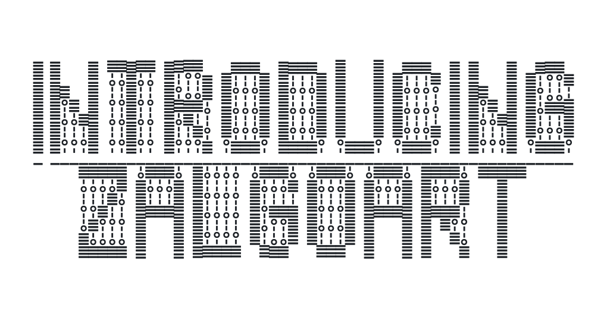
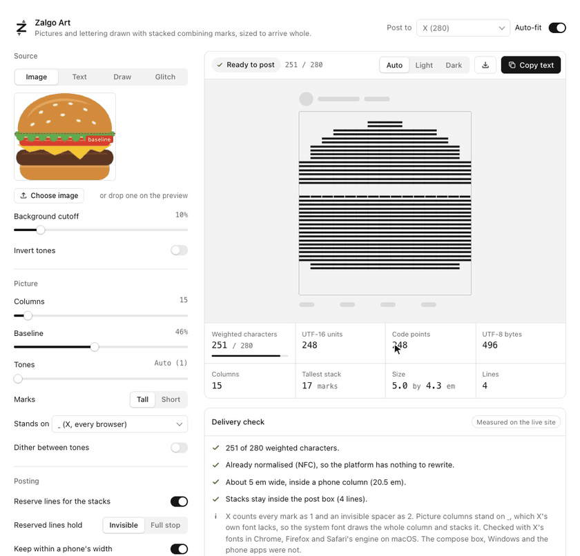
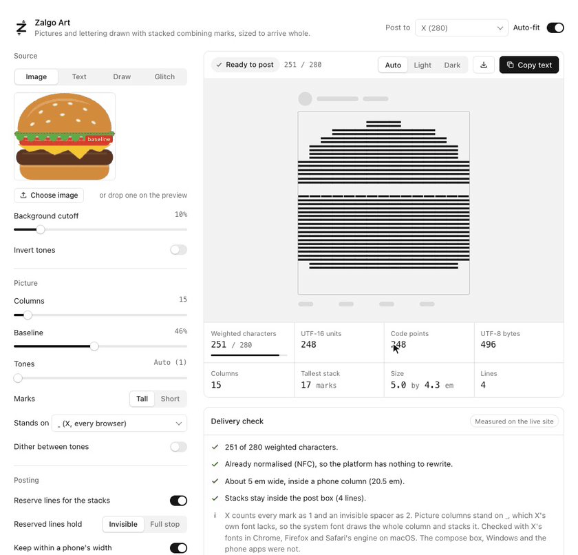
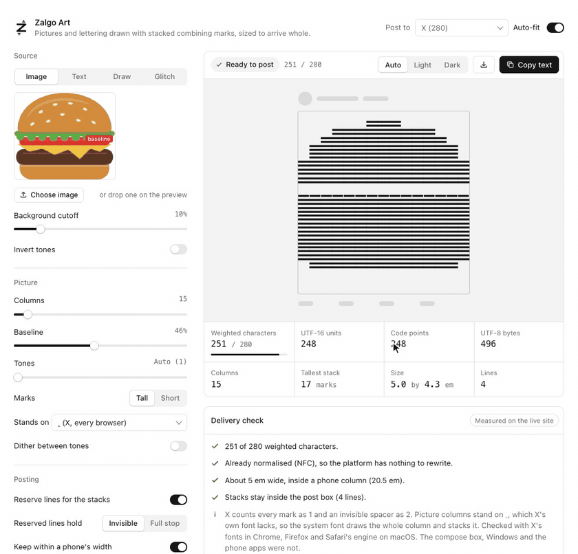

<!-- lettering:start made by tools/readme.js from examples/introducing-zalgoart.x-premium.txt, do not edit by hand -->
<p align="center">⠀<br>⠀<br>⠀<br>ˍ̿̿̿̿̿̿̿̿̿̿̿̿̿̿ ˍ̿̿̿̿̿̿̿̿̿̿̿̿̿̿ˍ̍̊̍̍̊̍̍̊̿̿ˍ̍̊̍̍̊̍̿̿ˍ̳̳̩̥̩̩̥̩̩̥̳̳̳̳̍̊̍̍̿̿ˍ̳̳̩̥̩̩̥̩̳̳̩̥̳̳̿̿̿̿̿̿̿̿̿̿̿̿̿̿ˍ̳̳̩̥̩̩̳̳̥̩̩̥̳̳ˍ̳̳̩̥̳̳̩̩̥̩̩̥̳̳̍̊̍̍̊̍̍̊̍̍̊̍̿̿ˍ̳̳̳̳̩̥̩̩̥̩̩̥̳̳̍̊̍̍̊̍̍̊̍̍̊̍̿̿ˍ̿̿̿̿̿̿̿̿̿̿̿̿̿̿ˍ̩̥̳̳̳̳̳̳̳̳̳̳̳̳̍̊̍̍̊̍̍̊̍̍̊̍̿̿ˍ̳̳̩̥̩̩̳̳̍̊̍̍̊̍̍̊̍̍̊̍̿̿ˍ̳̳̩̥̩̩̳̳ˍ̳̳̩̥̩̩̳̳̿̿̿̿̿̿̿̿̿̿̿̿̿̿ˍ̩̥̳̳̳̳̳̳̳̳̳̳̳̳̍̊̍̍̊̍̿̿̍̊̍̍̿̿ˍ̍̊̍̍̿̿̿̿̊̍̍̊̿̿ˍ̳̳̳̳̳̳̳̳̳̳̳̳̳̳̍̊̿̿̍̍̿̿̊̍̍̊̿̿ˍ̩̥̩̩̥̩̩̥̩̩̥̩̳̳̿̿̍̊̍̍̊̍̿̿̿̿ˍ̩̥̩̩̥̩̩̥̩̩̥̩̳̳ˍ̩̥̩̩̥̩̩̥̩̩̥̩̳̳̍̊̿̿̿̿̿̿̿̿̿̿ˍ̩̥̩̩̥̩̩̥̩̩̥̩̳̳̿̿̍̊̍̍̊̍̍̊̍̍̿̿ˍ̿̿̍̊̍̍̊̍̍̊̍̍̿̿ˍ̩̥̳̳̳̳̳̳̳̳̳̳̿̿̍̊̍̍̊̍̍̊̍̍̿̿ˍ̳̳̩̥̩̩̥̩̩̥̩̩̳̳̍̊̿̿̿̿̿̿̿̿̿̿ˍ̳̳̩̥̩̩̳̳̥̩̩̥̳̳ˍ̳̳̩̥̩̩̳̳̥̩̩̥̳̳̿̿̿̿̿̿̿̿̿̿̿̿̿̿ˍ̩̥̳̳̩̩̳̳̳̳̳̳̿̿̍̊̍̍̊̍̍̊̍̍̿̿ˍ̿̿̍̊̍̍̊̍̍̊̍̍̿̿ˍ̩̥̳̳̳̳̳̳̳̳̳̳̿̿̍̊̍̍̊̍̍̊̍̍̿̿ˍ̳̳̩̥̩̩̥̩̩̥̩̩̳̳̍̊̿̿̿̿̿̿̿̿̿̿ˍ̳̳̩̥̩̩̥̩̩̥̩̩̳̳ˍ̳̳̩̥̩̩̥̩̩̥̩̩̳̳̍̊̿̿̿̿̿̿̿̿̿̿̿̿ˍ̩̥̳̳̳̳̳̳̳̳̳̳̿̿ˍ̿̿ˍ̩̥̳̳̳̳̳̳̳̳̳̳̳̳̿̿ˍ̳̳̩̥̩̩̳̳̍̊̿̿̿̿̿̿̿̿̿̿̿̿ˍ̳̳̩̥̩̩̳̳ˍ̳̳̩̥̩̩̳̳̍̊̿̿̿̿̿̿̿̿̿̿ˍ̩̥̳̳̳̳̳̳̳̳̳̳̳̳̿̿̍̊̍̍̊̍̍̊̍̍̿̿ˍ̿̿̍̊̍̍̊̍̍̊̍̍̿̿ˍ̳̳̳̳̳̳̳̳̳̳̳̳̳̳̿̿̍̊̍̍̊̍̍̊̍̍̿̿ˍ̳̳̩̥̩̩̳̳̍̊̿̿̍̍̊̍̍̊̿̿ˍ̳̳̩̥̩̩̳̳̳̳ˍ̳̳̩̥̩̩̳̳̥̩̳̳̿̿̿̿̿̿̿̿̿̿̿̿̿̿ˍ̩̥̳̳̳̳̩̩̥̩̩̥̳̳ˍ̿̿̿̿̿̿̿̿̿̿̿̿̿̿ˍ̳̳̍̊̍̍̊̍̍̊̿̿ˍ̳̳̍̊̍̍̊̍̿̿ˍ̳̳̳̳̳̳̳̳̳̳̳̳̳̳̍̊̍̍̿̿ˍ̳̳̿̿̿̿̿̿̿̿̿̿̿̿̿̿ˍ̳̳ˍ̍̊̿̿̿̿̿̿̿̿̿̿ˍ̿̿̍̊̍̍̊̍̍̊̍̍̿̿ˍ̿̿̍̊̍̍̿̿̊̍̍̊̿̿ˍ̿̿̍̊̍̍̿̿̊̍̍̊̿̿ˍ̍̊̿̿̿̿̿̿̍̍̿̿<br>⠀<br>⠀<br>⠀</p>
<!-- lettering:end -->

<h1 align="center">ZalgoArt</h1>

<p align="center">
  Pictures, drawings and words as <b>one line of text</b> made of stacked Unicode combining marks,
  sized so the post arrives whole on X, Bluesky, Discord, Slack and more.
</p>

<p align="center">
  <a href="https://jackulau.github.io/ZalgoArt/"></a>
  <a href="https://github.com/jackulau/ZalgoArt/stargazers"></a>
  <a href="LICENSE"></a>
  
</p>

<p align="center">
  <b><a href="https://jackulau.github.io/ZalgoArt/">Try it in your browser</a></b>
  &nbsp;·&nbsp;
  <a href="https://github.com/jackulau/ZalgoArt/stargazers">Star this project</a> if it made you smile
</p>

The lettering at the top of this page is not a picture. It is one line of text, the same text `zalgo text "Introducing ZalgoArt" -p xpremium` prints, and you can select it and paste it somewhere else.

<details>
<summary>Does the lettering look scrambled? This is what it should look like.</summary>
<br>
<p align="center">
  <picture>
    <source media="(prefers-color-scheme: dark)" srcset="assets/lettering-dark.png">
    
  </picture>
</p>

How the marks stack depends on the reader's fonts. The picture was taken on a Mac, where Chrome, Firefox and Safari all stack them. Windows, Android and the GitHub phone app have not been checked. See [What has been checked](#what-has-been-checked).
</details>

## Demo

Four short recordings, one for each kind of source. Each is the real site driven by a script ([tools/demo.js](tools/demo.js)) and ends on Copy. Click a recording to open the site, or follow its video link for the MP4.

### Image

A picture becomes one line of text. Switching from X to Discord gives it room for more columns and tones. ([watch as video](https://jackulau.github.io/ZalgoArt/demo/image.mp4))

<p align="center">
  <a href="https://jackulau.github.io/ZalgoArt/"></a>
</p>

### Text

Words in big letters built from marks: type, pick a platform, copy. ([watch as video](https://jackulau.github.io/ZalgoArt/demo/text.mp4))

<p align="center">
  <a href="https://jackulau.github.io/ZalgoArt/"></a>
</p>

### Draw

Draw on the canvas and the text follows. Above the red line grows up, below it grows down. ([watch as video](https://jackulau.github.io/ZalgoArt/demo/draw.mp4))

<p align="center">
  <a href="https://jackulau.github.io/ZalgoArt/"></a>
</p>

### Glitch

Classic glitch text, with the pile heights under your control and a reroll for new marks. ([watch as video](https://jackulau.github.io/ZalgoArt/demo/glitch.mp4))

<p align="center">
  <a href="https://jackulau.github.io/ZalgoArt/"></a>
</p>

The burger in the recordings is [examples/burger.svg](examples/burger.svg), drawn from plain shapes for this project and covered by the same MIT licence.

## What it does

Zalgo text works by piling combining marks (accents, dots, bars, rings) above and below a letter. Most tools use that for noise. ZalgoArt uses the piles as pixels.

- **Image.** Drop in a picture. Each column of the picture becomes one letter with a pile of marks, light or heavy marks standing for the shade.
- **Draw.** Brush, line, box, oval and fill on a canvas ruled with the same grid the text uses, with undo and redo. The preview updates as you draw.
- **Text.** Big letters built from piles of marks, one pile per column, with an optional plain caption above.
- **Glitch.** The classic effect, thinned automatically so it still fits.
- **Fits the limit.** Every platform counts differently (X weighs characters, Bluesky counts graphemes and bytes, Discord counts UTF-16 units). ZalgoArt counts the way the platform does and picks the largest size that fits.
- **Arrives whole.** Tall piles spill out of their line, and many sites cut off whatever leaves the post. ZalgoArt reserves blank lines above and below, keeps the text inside a phone's width, and lists each check with a pass or a fail before you post.
- **Site and command line agree.** Both run the same file, [src/zalgo-core.js](src/zalgo-core.js), and the tests compare their output byte for byte.

## Use the site

Open **https://jackulau.github.io/ZalgoArt/**. Pick where you will post, pick a source (Image, Text, Draw or Glitch), and press **Copy text**. It is one HTML file with nothing to install, nothing uploaded and no tracking: your picture never leaves the browser. Light and dark themes follow your system.

To run it from a clone, open `docs/index.html` in a browser.

## Use the command line

Needs [Node.js](https://nodejs.org) 18 or newer. There are no packages to install.

```sh
git clone https://github.com/jackulau/ZalgoArt.git
cd ZalgoArt
./bin/zalgo text "hello"
```

To have `zalgo` on your path:

```sh
npm install -g https://github.com/jackulau/ZalgoArt/archive/refs/heads/main.tar.gz
```

It is not on the npm registry. Install from the tarball as shown: with npm 10, `npm install -g github:jackulau/ZalgoArt` leaves a broken link.

| Command | What it does |
| --- | --- |
| `zalgo image <file>` | Turn a picture into one line of text |
| `zalgo text <words...>` | Write words in big letters built from marks |
| `zalgo glitch <text...>` | Classic glitch text |
| `zalgo count [file]` | Count text every way a platform might |
| `zalgo check [file]` | Will this text arrive whole on a platform |
| `zalgo platforms` | The platforms, their limits and how well each is checked |
| `zalgo help` | Every option |

```sh
zalgo image photo.png                          # fit X, print the text
zalgo image photo.jpg -p bluesky --copy        # fit Bluesky, copy to the clipboard (macOS)
zalgo image logo.png -p discord --cols 40 --tones 3 -o post.txt
zalgo text "Introducing ZalgoArt" -p xpremium  # the lettering at the top of this page
zalgo text zalgoart --caption Introducing      # letters with a plain line above
zalgo glitch "something is wrong" -p bluesky
zalgo check post.txt -p x                      # exit code 0 when every check passes
echo "any text" | zalgo count                  # every count, and which platforms it fits
```

The text goes to standard output and a summary to standard error, so a pipe carries only the text:

```
$ zalgo image examples/burger.jpg > post.txt
X (280): 251 of 280 weighted characters
  15 columns, 5.0 em wide, 2.1 em up, 2.3 em down
  4 lines: 1 reserved above, 2 below
  tones 1 (automatic), base low, baseline 46% (automatic), font Helvetica
  [ok]   251 of 280 weighted characters.
  [ok]   Already normalised (NFC), so the platform has nothing to rewrite.
  [ok]   About 5 em wide, inside a phone column (20.5 em).
  [ok]   Stacks stay inside the post box (4 lines).
  [note] ...what was and was not checked for this platform
```

PNG files are read directly on any system. JPEG, GIF, HEIC and WebP are converted with `sips`, which ships with macOS; on other systems, convert to PNG first. `--json` prints the text, counts, checks and options for scripts.

## How it works

1. **One column, one letter.** A column of the picture is written as a base letter followed by a run of combining marks from U+0300 to U+036F. Marks that sit below the letter are written first, then the marks above.
2. **Marks are the shades.** Double bars are dark, dots are mid, ticks are light. A cell takes the shade most of its pixels have, so the edge of a flat shape stays flat.
3. **Fonts are measured, not guessed.** How far each mark moves the pile differs by font. [src/zalgo-cal.js](src/zalgo-cal.js) asks the browser, and the results for Helvetica and Arial are saved in [profiles/](profiles) for the command line.
4. **The platform's font must not draw the column.** X and Slack use their own fonts, which do not stack marks. So each column stands on a letter those fonts lack (U+02CD on X), which makes the browser hand the whole column to a system font that does stack.
5. **Room is reserved.** Blank lines holding an invisible character (U+2800) go above and below, so the piles land inside the post and are not cut off.
6. **The count is the platform's.** Weighted characters for X, graphemes and bytes for Bluesky, UTF-16 units for Discord, and so on. The size is the largest one that passes.

## Platforms

Limits and how each was checked, as `zalgo platforms` prints them:

| Platform | Limit | Counted in | Checked |
| --- | --- | --- | --- |
| X | 280 | weighted characters | measured |
| X Premium | 25,000 | weighted characters | measured |
| Bluesky | 300 | graphemes (and 3,000 UTF-8 bytes) | measured |
| Mastodon | 500 | characters, as the web composer counts | documented |
| Discord | 2,000 | UTF-16 units | documented |
| Discord Nitro | 4,000 | UTF-16 units | documented |
| Reddit comment | 10,000 | code points | documented |
| Telegram | 4,096 | UTF-16 units | documented |
| Twitch chat | 500 | UTF-16 units | documented |
| SMS (one segment) | 70 | UTF-16 units | documented |
| Slack | 4,000 | UTF-16 units | font |
| Threads | 500 | UTF-16 units | unverified |
| Instagram caption | 2,200 | UTF-16 units | unverified |
| TikTok comment | 150 | UTF-16 units | unverified |
| YouTube comment | 10,000 | UTF-16 units | unverified |
| WhatsApp | 65,536 | UTF-16 units | unverified |
| Facebook post | 63,206 | UTF-16 units | unverified |
| Custom | any | UTF-16 units | |

- **measured**: the layout was measured on the live site in Chrome on macOS.
- **font**: only the stacking was measured, in the platform's own font stack.
- **documented**: the limit comes from the platform's documentation. Rendering was not measured.
- **unverified**: a best guess. Check before relying on it.

## What has been checked

- X: output rendered with X's own fonts in Chrome, Firefox and Safari's engine on macOS, where the piles stack in all three. Glitch text on X is flat in Firefox, and the site warns about it.
- This README: the lettering on the published GitHub page stacks in Chrome (desktop and phone width, light and dark) and Firefox on macOS. Safari's engine was checked on a local copy with the same fonts, not on github.com.
- Safari and the iPhone, iPad and Mac apps stack only the first 30 marks of a column, so 30 is the default cap. `--dense` lifts it.

Not checked: the X compose box, Windows, Android, and every phone app. Fonts differ there, so a pile may stack lower, flatter or not at all. If you post from one of those and it looks wrong, an issue with a screenshot helps.

## Development

```
bin/zalgo            the command line tool
src/zalgo-core.js    the encoder, shared by the site and the command line
src/zalgo-cal.js     font calibration, browser only
src/png.js           PNG decoder for the command line
src/site.html        the site's source
docs/index.html      the built site, served by GitHub Pages
profiles/            saved font measurements (Helvetica, Arial)
examples/            a sample picture (burger.svg and its JPEG) and saved output
test/                the tests
tools/               font tables, profiles, the demo recordings, README pictures
```

```sh
npm test         # every test, about five minutes. Needs Node; Chrome and macOS sips unlock the rest
npm run build    # rebuild docs/index.html after changing src/ or examples/burger.jpg
node tools/demo.js   # record the four demo clips again (needs Playwright and ffmpeg)
```

Run a few tests by name with `ZALGO_ONLY='^text|^cli' npm test`. The tests check that `docs/index.html` is the current build, that the files in `examples/` are what the commands print, and that this README holds the same lettering as `examples/`. After changing the lettering, run `node tools/readme.js images`.

Plain JavaScript, no framework, no bundler and no dependencies. Issues and pull requests are welcome.

## Star history

If ZalgoArt was useful or just fun, [give it a star](https://github.com/jackulau/ZalgoArt/stargazers). It is the easiest way to help other people find it.

<p align="center">
  <a href="https://www.star-history.com/?repos=jackulau%2FZalgoArt&type=date&legend=top-left">
    <picture>
      <source media="(prefers-color-scheme: dark)" srcset="https://api.star-history.com/chart?repos=jackulau/ZalgoArt&type=date&legend=top-left&theme=dark">
      
    </picture>
  </a>
</p>

## License

[MIT](LICENSE). Copyright (c) 2026 Jack Lau.
